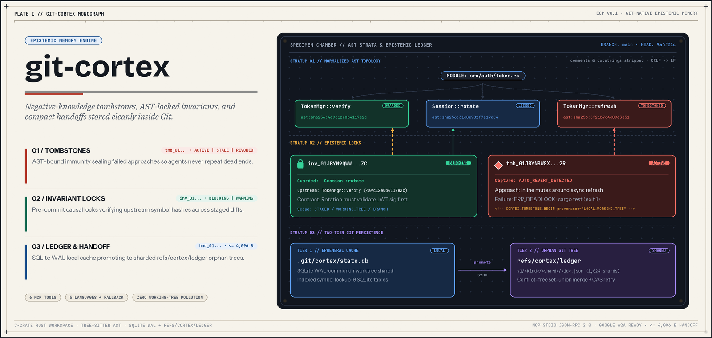
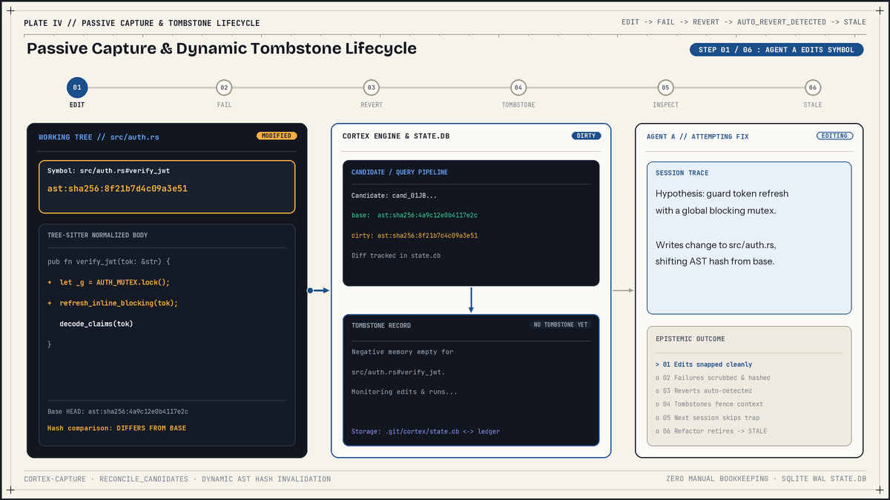
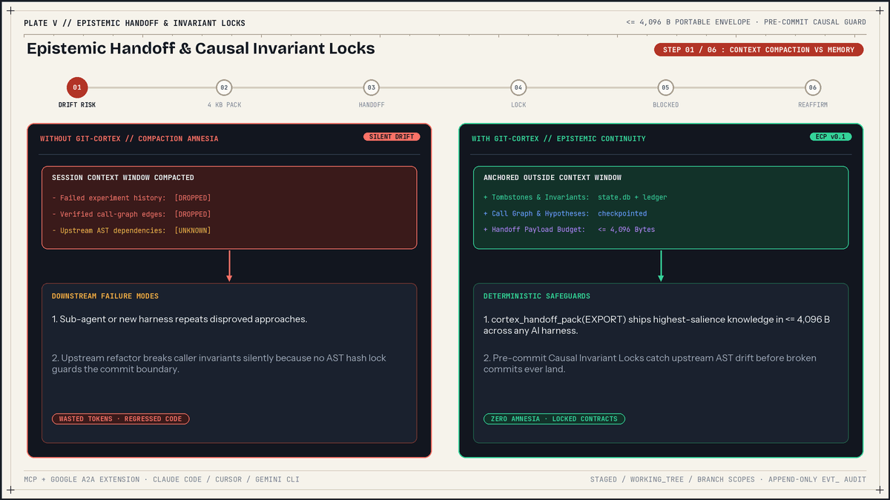

# git-cortex

Git-native working memory, negative-knowledge tombstones, and causal invariant locks for AI coding agents implementing the Epistemic Context Protocol (ECP v0.1).

[](https://github.com/augastinklazar/git-cortex/actions/workflows/ci.yml)
[](LICENSE-MIT)



## Problems solved

Autonomous coding sessions break down repeatedly in three places where standard Git history and plain text notes fall short:

1. Context compaction drops failed attempts. When an agent session compacts or restarts, the negative knowledge explaining why an edit failed disappears first, so the agent repeats the same dead end. `git-cortex` records AST-bound tombstones (`tmb_...`) keyed by a symbol hash (`ast:sha256:...`) and marks them stale automatically when that symbol changes.
2. Sub-agent and cross-harness handoffs waste tokens. Moving work between Claude Code, Cursor, Gemini CLI, Codex CLI, or sub-agents forces each new session to re-read files and rebuild call graphs. `EpistemicHandoff` envelopes (`hnd_...`) pack verified call-graph edges, active hypotheses, tombstone IDs, and unchanged-file markers within a strict 4,096-byte budget, with JSON-RPC formatting for MCP and Google A2A `tasks/send`.
3. Textual merges miss semantic drift. Git tracks line diffs while downstream callers rely on behavioral preconditions across files. Causal Invariant Locks (`inv_...`) pin guarded symbols and upstream dependencies to expected AST hashes so `git cortex verify-invariants` and `pre-commit` hooks catch upstream changes before broken commits land.

## How git-cortex works

All epistemic state lives in Git and a local cache outside your working-tree source files:

- Tier 1 (`state.db` in `.git/cortex/`) is an ephemeral SQLite WAL database shared across linked worktrees via `commondir`. It holds session records, symbol indexes, passive-capture runs, checkpoints, file read digests, call-graph edges, and hypotheses.
- Tier 2 (`refs/cortex/ledger`) is an append-only orphan Git commit tree holding sharded RFC 8785 canonical JSON records (`v1/<kind>/<shard>/<id>.json`). Syncing across branches or clones performs set-union tree merges and stops with a tamper error if identical paths carry different blob OIDs.
- Tree-sitter AST extraction assigns symbol URIs (`path#Scope.symbol` or `path#Scope::symbol`) and computes `ast:sha256:<16hex>` digests after stripping comments, Python docstrings, and line-ending differences.



Wrapping test or build commands with `git cortex exec -- <cmd>` enables passive capture. When a dirty symbol fails a command and you later revert it back to its base `HEAD` AST hash, `git-cortex` reconciles the candidate and promotes an `AUTO_REVERT_DETECTED` tombstone without manual logging. Once a subsequent edit changes that symbol's AST hash, `inspect` treats the old tombstone as `STALE`.



## Installation

Both `git cortex <command>` (via Git subcommand lookup) and `cortex <command>` invoke the same CLI implementation.

### Cargo (from source)

```bash
# From a local clone (installs both 'git-cortex' and 'cortex')
cargo install --path crates/cortex-cli

# Or directly from GitHub
cargo install --git https://github.com/augastinklazar/git-cortex cortex-cli
```

`Cargo.toml` sets `rust-version = "1.80"`, while the locked dependencies in `Cargo.lock` (`clap 4.6.7` and `tempfile 3.27.0`) require a newer Rust toolchain when building with the lockfile. Building from source also requires a C compiler and linker for bundled SQLite, `libgit2`, and Tree-sitter. Windows developers on cloud-synced drives (Google Drive, OneDrive) or LLVM-MinGW toolchains should copy [`.cargo/config.toml.example`](.cargo/config.toml.example) to `.cargo/config.toml`; see [docs/GETTING-STARTED.md](docs/GETTING-STARTED.md).

### npx (Node.js 16+)

```bash
npx git-cortex init
```

The wrapper script [`npm/bin/git-cortex.js`](npm/bin/git-cortex.js) checks `GIT_CORTEX_BIN`, bundled binaries, `~/.git-cortex/bin`, `target/release`, and `PATH`. If none exist, it downloads the matching release archive from GitHub Releases and verifies it against `SHA256SUMS.txt`. On Windows (`win32`), `npx` currently resolves to `x86_64-pc-windows-msvc` only.

### Prebuilt GitHub releases

Archive builds on [GitHub Releases](https://github.com/augastinklazar/git-cortex/releases) cover Linux x64 (`x86_64-unknown-linux-gnu`), Linux ARM64 (`aarch64-unknown-linux-gnu`), macOS x64 (`x86_64-apple-darwin`), macOS ARM64 (`aarch64-apple-darwin`), and Windows x64 (`x86_64-pc-windows-msvc`). Release archives currently package the `git-cortex` binary only (omitting the separate `cortex` binary), and Windows ARM64 archives are not yet built.

### Homebrew (source formula)

The repository includes a source formula at [`packaging/homebrew/git-cortex.rb`](packaging/homebrew/git-cortex.rb) that builds `crates/cortex-cli` with Cargo. Its `v0.1.0` `sha256` field currently holds the placeholder `REPLACE_WITH_RELEASE_TARBALL_SHA256`, so versioned tarball installs require filling in the release checksum or installing via Cargo.

## Quickstart

Initialize `git-cortex` inside an existing Git repository:

```bash
git cortex init
git cortex doctor
```

`git cortex init` initializes `.git/cortex/state.db`, sets the safe remote-tracking fetch refspec (`+refs/cortex/ledger:refs/remotes/origin/cortex/ledger`), installs four chained Git hooks (`pre-commit`, `post-commit`, `post-checkout`, `post-merge`), appends agent instructions to `AGENTS.md` and `CLAUDE.md`, and merges `"git-cortex"` into `.mcp.json`.

Inspect symbols and active constraints before editing a file:

```bash
git cortex symbols src/lib.rs
git cortex inspect src/lib.rs
```

Run tests under passive capture so reverted failures turn into tombstones automatically:

```bash
git cortex exec -- cargo test
```

Save a recovery checkpoint and export a compact handoff envelope for another agent or session:

```bash
git cortex checkpoint -m "Verify token validation before refactor"
git cortex handoff export --out handoff.json
```

Promote local records to `refs/cortex/ledger` and sync with `origin`:

```bash
git cortex promote
git cortex sync
```

## CLI reference

All 17 commands work with either `git cortex <command>` or `cortex <command>`. See [docs/CLI-REFERENCE.md](docs/CLI-REFERENCE.md) for every flag, default value, and JSON output schema.

| Command | Purpose |
|---|---|
| `init` | Initialize `state.db`, ledger fetch refspec, chained hooks, `AGENTS.md`/`CLAUDE.md`, and `.mcp.json` |
| `status` | Show branch, `HEAD`, working-tree dirty hash, and epistemic counts (`--json`) |
| `inspect <filepath> [symbol]` | Return active and stale fenced tombstones and invariants (`--json`) |
| `symbols <filepath>` | Extract and print AST symbol URIs and `ast:sha256` hashes (`--json`) |
| `exec [-t <secs>] -- <cmd...>` | Execute a command with passive Edit, Fail, Revert capture |
| `tombstone <add\|list\|show\|revoke>` | Create, inspect, or revoke negative-knowledge tombstones |
| `invariant <add\|list\|show\|reaffirm\|revoke>` | Create, inspect, reaffirm, or revoke causal invariant contracts |
| `checkpoint [-m <msg>]` | Snapshot working tree to `refs/cortex/checkpoints/` and upsert graph/hypotheses |
| `rewind <checkpoint_id> [-r <reason>]` | Back up dirty state, restore checkpoint tree, and synthesize an immunity tombstone |
| `handoff <export\|import>` | Export (`--a2a`, `--out`) or import (`--file`, stdin) 4,096-byte `EpistemicHandoff` envelopes |
| `verify-invariants` | Statically verify invariants across `--working-tree` (default), `--staged`, or `--branch` |
| `promote` | Write unpromoted local tombstones, invariants, and events to `refs/cortex/ledger` |
| `sync [remote] [--rebase]` | Fetch, merge, reindex, and push `refs/cortex/ledger` with backoff retries |
| `reindex` | Rebuild `.git/cortex/state.db` from `refs/cortex/ledger` |
| `hook <name>` | Internal handler for `pre-commit`, `post-commit`, `post-checkout`, and `post-merge` |
| `mcp-serve` | Start the stdio JSON-RPC 2.0 MCP server (`Content-Length` or NDJSON) |
| `doctor` | Check repository, `commondir`, SQLite DB, ledger ref, hooks, instructions, and `.mcp.json` |

## MCP tools

`git cortex mcp-serve` exposes 6 tools over MCP protocol version `2024-11-05`. Every `tools/call` also runs candidate reconciliation so reverted passive-capture failures become active tombstones immediately. See [docs/MCP-AND-INTEGRATION.md](docs/MCP-AND-INTEGRATION.md) for input schemas and harness recipes.

| Tool | Required parameters | Purpose |
|---|---|---|
| `cortex_inspect_symbol` | `filepath` | Retrieve fenced active and stale tombstones and invariants before editing |
| `cortex_record_tombstone` | `target_symbols`, `attempted_approach`, `failure_reason` | Record a failed approach bound to current symbol AST hashes |
| `cortex_checkpoint_state` | `objective` | Save verified call-graph edges, active hypotheses, and a working-tree snapshot |
| `cortex_handoff_pack` | `mode` (`EXPORT` or `IMPORT`) | Export a 4,096-byte handoff or ingest a supplied `envelope` payload |
| `cortex_verify_invariants` | None (`diff_scope` optional) | Statically check invariants across `WORKING_TREE` (default), `STAGED`, or `BRANCH` |
| `cortex_record_invariant` | `guarded_symbol`, `assertion`, `verification_test_cmd` | Lock a guarded symbol and optional `upstream_dependencies` with `BLOCKING` or `WARNING` severity |

Note on `IMPORT`: calling `cortex_handoff_pack(mode="IMPORT")` without an `envelope` object returns an error (`Missing 'envelope' payload for IMPORT mode`). Obtain an envelope from a prior `EXPORT` call or `git cortex handoff export` before importing.

## Supported languages and hashing latency

Tree-sitter symbol extraction and normalized AST hashing support six language grammars:

| Language | Extensions | Scope separator |
|---|---|---|
| Rust | `.rs` | `::` |
| TypeScript | `.ts`, `.mts`, `.cts` | `.` |
| TSX | `.tsx` | `.` |
| JavaScript | `.js`, `.mjs`, `.cjs`, `.jsx` | `.` |
| Python | `.py`, `.pyi` | `.` |
| Go | `.go` | `.` |

Unsupported text extensions and supported files with zero extracted symbols fall back to a whole-file `<path>#<file>` entry hashed across trimmed non-empty lines. Files larger than 2 MiB (`2 * 1024 * 1024` bytes) or containing a NUL byte in the first 1,024 bytes fall back to `<path>#<binary>` hashed over raw file bytes.

Measured release hashing latency from `cargo test -p cortex-ast --test bench_hashing --release -- --nocapture`:

| Fixture | Symbol count | Measured release time |
|---|---|---|
| TypeScript 1,080 LOC | 120 functions | 6.7 ms |
| Rust 1,200 LOC | 150 functions | 12.9 ms |
| Python 1,200 LOC | 150 functions | 15.1 ms |
| TypeScript 10,002 lines | 2,001 symbols | 659.1 ms |

The three ~1,100 to 1,200 LOC benchmarks pass the CI release assertion of 35 ms or less.

## Security model

`git cortex verify-invariants` and MCP `cortex_verify_invariants` perform static AST hash checks only and never run `verification_test_cmd`. By contrast, the `pre-commit` Git hook installed by `git cortex init` calls `verify_and_reaffirm_invariants` with auto-reaffirmation enabled. When staged changes drift on a `BLOCKING` invariant that defines `verification_test_cmd`, the hook executes that command via `sh -c` on Unix or `cmd /C` on Windows with a 30-second timeout. Exit `0` reaffirms the contract, while any other exit code blocks the commit. Inspect `.git/hooks/pre-commit` and recorded invariants before committing inside untrusted repositories.

Tombstone and invariant fields pass through `cortex_core::redact::scrub` (13 secret regex rules plus a Shannon high-entropy scanner) and `cortex_core::fence::sanitize_text` (length caps, ANSI/OSC/Bidi/Unicode-tag stripping, and `<!--` / `-->` comment delimiter neutralization) before fencing. Read [SECURITY.md](SECURITY.md) for the complete threat matrix, replacement tokens, and known redaction gaps.

## Documentation

| Document | Audience and scope |
|---|---|
| [docs/README.md](docs/README.md) | Documentation hub indexed by reader role and schema file |
| [docs/GETTING-STARTED.md](docs/GETTING-STARTED.md) | Prerequisites, installation, Windows build setup, first session, worktrees, and troubleshooting |
| [docs/AGENT-GUIDE.md](docs/AGENT-GUIDE.md) | Agent operating protocol, fenced output rules, handoff sizing, and harness snippets |
| [docs/MCP-AND-INTEGRATION.md](docs/MCP-AND-INTEGRATION.md) | Stdio JSON-RPC 2.0 transport, 6 MCP tool schemas, client configs, and Git hooks |
| [docs/CLI-REFERENCE.md](docs/CLI-REFERENCE.md) | All 17 commands, subcommands, flags, defaults, JSON outputs, and exit codes |
| [docs/SCHEMAS.md](docs/SCHEMAS.md) | Prefixed ULIDs, RFC 8785 JCS hashing, and v0.1 JSON Schemas |
| [docs/CONCEPTS-AND-STORAGE.md](docs/CONCEPTS-AND-STORAGE.md) | SQLite WAL, `refs/cortex/ledger`, AST hashing, lifecycles, passive capture, and rewind |
| [docs/ARCHITECTURE.md](docs/ARCHITECTURE.md) | Seven-crate workspace topology, responsibilities, and benchmarks |
| [docs/FAQ.md](docs/FAQ.md) | Answers on storage footprint, worktrees, `IMPORT` envelopes, hooks, and packaging |
| [docs/spec/ECP-v0.1.md](docs/spec/ECP-v0.1.md) | Normative Epistemic Context Protocol v0.1 specification |
| [docs/spec/git-cortex Architecture & MVP Specification.pdf](docs/spec/git-cortex%20Architecture%20&%20MVP%20Specification.pdf) | Original architecture and MVP design document (PDF) |
| [git-cortex-Technical-Audit-and-Remediation-Specification.pdf](git-cortex-Technical-Audit-and-Remediation-Specification.pdf) | Technical audit and remediation specification (PDF) |
| [SECURITY.md](SECURITY.md) | Threat boundaries, hook execution policy, redaction rules, and vulnerability reporting |
| [CONTRIBUTING.md](CONTRIBUTING.md) | Developer setup, workspace test suites, lint checks, and PR guidelines |
| [CHANGELOG.md](CHANGELOG.md) | Release notes and verified v0.1.0 baseline |

## License

Dual-licensed under [MIT](LICENSE-MIT) or [Apache-2.0](LICENSE-APACHE).
