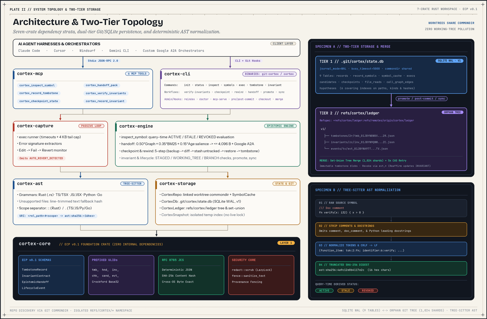

# System and crate architecture

`git-cortex` is a local-first epistemic memory engine built in Rust as a 7-crate workspace (`version = "0.1.0"`, `edition = "2021"`, `license = "MIT OR Apache-2.0"`). It stores failed approaches, verified call graphs, behavioral invariant contracts, and handoff envelopes inside Git refs and a local SQLite database without editing tracked source files.

## High-level component topology



In the `v0.1.0` codebase, `EpistemicHandoff` envelopes stay outside `records` and `refs/cortex/ledger` (exported on demand), and `inspect_symbol` groups deleted symbols into stale lists while leaving `DerivedStatus::Orphaned` unused.

The workspace crate graph forms an acyclic dependency stack where `cortex-capture` calls `cortex-engine` to promote reverted candidates into tombstones:

```text
+-------------------------------------------------------------------------+
|                        AI AGENT / CLI USER                              |
|  (Claude Code, Cursor, Windsurf, Gemini CLI, Codex CLI, Human Shell)    |
+------------------------------------+------------------------------------+
                                     |
          +--------------------------+--------------------------+
          | JSON-RPC 2.0 (stdio)                                | CLI & Git Hooks
          v                                                     v
+-------------------+                                 +-------------------+
|    cortex-mcp     |                                 |    cortex-cli     |
|  6 MCP tools      |                                 |  git-cortex &     |
|  Content-Length   |                                 |  cortex binaries  |
|  & NDJSON framing |                                 |  17 subcommands   |
+---------+---------+                                 +---------+---------+
          |                                                     |
          +--------------------------+--------------------------+
                                     |
                 +-------------------+-------------------+
                 v                                       v
       +-------------------+                   +-------------------+
       |  cortex-capture   |------------------>|   cortex-engine   |
       |  exec runner      |  record_tombstone |  inspect, handoff |
       |  error signature  |                   |  invariant, sync  |
       |  candidate revert |                   |  checkpoint, etc. |
       +---------+---------+                   +---------+---------+
                 |                                       |
                 +-------------------+-------------------+
                                     v
                           +-------------------+
                           |  cortex-storage   |
                           |  SQLite WAL DB    |
                           |  refs/cortex/*    |
                           |  SymbolCache      |
                           +---------+---------+
                                     |
                                     v
                           +-------------------+
                           |    cortex-ast     |
                           |  Tree-sitter AST  |
                           |  ast:sha256 hash  |
                           |  URI normalization|
                           +---------+---------+
                                     |
                                     v
                           +-------------------+
                           |    cortex-core    |
                           |  schemas & ULIDs  |
                           |  RFC 8785 JCS     |
                           |  redact & fence   |
                           +-------------------+
```

## Workspace crates

| Crate | Modules | Types and responsibilities |
|---|---|---|
| `cortex-core` | `error`, `id`, `jcs`, `redact`, `fence`, `schema` | Defines `CortexError` (15 variants), `PrefixedId` / `IdPrefix` (`tmb_`, `hnd_`, `inv_`, `chk_`, `cand_`, `evt_`), `to_canonical_json` / `canonical_hash` / `sha256_digest`, `scrub` (13 `REDACTION_RULES` + Shannon entropy scanner), `sanitize_text` / `fence_tombstone` / `fence_invariant` (`Provenance`), and all ECP record structs (`TombstoneRecord`, `EpistemicHandoff`, `InvariantContract`, `LifecycleEvent`, `DerivedStatus`). Has zero internal crate dependencies. |
| `cortex-ast` | `lang`, `uri`, `hash`, `extract` | Maps extensions to Tree-sitter grammars (`Rust`, `TypeScript`, `Tsx`, `JavaScript`, `Python`, `Go`, `Unsupported`), normalizes relative paths (`normalize_rel_path`, `parse_symbol_uri`), extracts `Symbol` entries with `SymbolKind`, and computes `ast:sha256:<16hex>` hashes (`compute_ast_hash_for_lang`, `compute_text_fallback_hash`). |
| `cortex-storage` | `repo`, `migrations`, `db`, `cache`, `ledger`, `snapshot`, `build.rs` | Resolves `.git` or linked worktree `commondir` (`CortexRepo`), opens SQLite WAL (`CortexDb`), runs v1 DDL (`apply_migrations`), caches extracted symbols in memory (`SymbolCache`), manages orphan ledger commits (`CortexLedger`, `LEDGER_REF`), and writes/restores working-tree snapshots via isolated temporary indexes (`CortexSnapshot`). `build.rs` links `advapi32` on Windows. |
| `cortex-engine` | `inspect`, `tombstone`, `invariant`, `checkpoint`, `handoff`, `rewind`, `promote`, `sync`, `lifecycle` | Implements query-time symbol inspection (`inspect_symbol`), sanitized tombstone creation (`record_tombstone`), static and hook-driven invariant verification (`verify_invariants`, `verify_and_reaffirm_invariants`), 4,096-byte handoff packing and A2A formatting (`create_handoff_envelope`, `import_handoff_envelope`, `format_a2a_task_envelope`), 5-step checkpoint rollback (`rewind_to_checkpoint`), ledger promotion and sync (`promote_local_records`, `sync_ledger`, `sync_ledger_rebase`), and record revocation/reaffirmation (`revoke_record`, `reaffirm_invariant`). |
| `cortex-capture` | `exec`, `signature`, `candidate` | Runs child processes with concurrent stdout/stderr capture and optional timeout killing (`execute_command`), extracts normalized error signatures (`extract_error_signature`), filters clean-tree baseline failures, and promotes reverted `FAILED` candidates into `AUTO_REVERT_DETECTED` tombstones (`reconcile_candidates`). Depends on `cortex-engine` to call `record_tombstone`. |
| `cortex-mcp` | `protocol`, `tools`, `server` | Runs the stdio JSON-RPC 2.0 server (`McpServer::run_stdio`) supporting `Content-Length` headers and NDJSON lines (`protocolVersion: "2024-11-05"`), validates arguments, runs `reconcile_candidates` on each `tools/call`, and exposes 6 tools (`list_tools`). |
| `cortex-cli` | `lib`, `init`, `hook`, `doctor`, `main`, `bin/cortex` | Ships both `git-cortex` and `cortex` binaries sharing `cortex_cli::run()`, strips an optional leading `"cortex"` argument for `git cortex` invocation, implements 17 subcommands, configures `.git/hooks/` and `.mcp.json` / `AGENTS.md` / `CLAUDE.md` (`init.rs`), executes Git hook handlers (`hook.rs`), and runs diagnostics (`doctor.rs`). |

## Storage design summary

`git-cortex` splits local ephemeral state from shared repository records across two storage tiers.

Tier 1 is a SQLite database at `.git/cortex/state.db` in primary repositories or `<commondir>/cortex/state.db` in linked `git worktree` checkouts (`CortexRepo::resolve_commondir`). Connection setup runs `PRAGMA journal_mode = WAL;`, `PRAGMA busy_timeout = 5000;`, and `PRAGMA foreign_keys = ON;`. Migration version `1` runs inside `TransactionBehavior::Immediate` to create 9 tables (`records`, `record_symbols`, `symbol_cache`, `execs`, `candidates`, `checkpoints`, `file_reads`, `call_graph_edges`, `hypotheses`) and 6 indexes. `PRAGMA synchronous = NORMAL` is not configured in `v0.1.0`.

Tier 2 is an orphan Git commit history at `refs/cortex/ledger`, tracked remotely with `+refs/cortex/ledger:refs/remotes/origin/cortex/ledger`. `promote_local_records` writes unpromoted `TOMBSTONE`, `INVARIANT`, and `EVENT` JSON blobs to `v1/<kind>/<shard>/<id>.json`, where `<shard>` is the last two lowercase characters of the ULID. Appends use a 5-attempt compare-and-swap retry loop (`10 * (attempt + 1)` ms backoff). `CortexLedger::merge_commits` merges divergent ledgers by tree set-union and aborts with a tamper alert if the same path maps to conflicting blob OIDs. `CortexLedger::reindex_into_db` rebuilds SQLite from the ledger in 500-item `Immediate` batches.

Working-tree snapshots live under `refs/cortex/checkpoints/<id>`, `refs/cortex/backups/<id>`, and `refs/cortex/untracked/<id>`, built with an isolated temporary index file (`tmp_index_<id>` under `repo.path().join("cortex")`) so `.git/index` stays untouched. For table schemas, index definitions, and merge retry details, see [Concepts and storage internals](./CONCEPTS-AND-STORAGE.md).

## AST hashing and invalidation rules

Symbol URIs combine a normalized forward-slash relative path and a language scope chain (`<rel_path>#<scope_chain>`). `cortex-ast` parses six languages (`rs` using `::` separator; `ts`/`mts`/`cts`, `tsx`, `js`/`mjs`/`cjs`/`jsx`, `py`/`pyi`, and `go` using `.` separator). Files over 2 MiB or containing `\0` in the first 1,024 bytes emit `<path>#<binary>`. Unsupported files or parsed files with zero extracted symbols emit `<path>#<file>` hashed line-by-line after trimming and dropping blank lines.

Tree-sitter subtree hashing walks every child index `0..node.child_count()` so operators, keywords, and punctuation enter the digest alongside named nodes. It drops comment nodes (`comment`, `line_comment`, `block_comment`, `doc_comment`, `inner_doc_comment`, `outer_doc_comment`) and leading Python docstrings, trims leaf text, normalizes `\r\n` to `\n`, and truncates SHA-256 to 16 hex chars (`ast:sha256:<16hex>`). Comments, Python docstrings, blank lines, indentation, and CRLF/LF line endings do not change `ast_hash`. Renaming identifiers or function parameters does change `ast_hash`, because leaf identifier text is hashed verbatim.

Record status is computed at query time on each inspect or verify call:

- `ACTIVE`: bound symbol URIs exist in current source with matching `ast_hash`, and no `REVOKE` event targets the record ID.
- `STALE`: one or more bound symbols changed `ast_hash` or disappeared from the file. Missing files and deleted symbols appear in `stale_tombstones` and `stale_invariants`, while `DerivedStatus::Orphaned` remains unused.
- `REVOKED`: an `EVENT` record with `event_type = "REVOKE"` targets the record ID.

## Epistemic record models

Persistent epistemic records serialize via `serde_jcs` (RFC 8785 Canonical JSON) with `schema_version = "0.1.0"`.

### TombstoneRecord

`TombstoneRecord` (`id` prefixed `tmb_`) stores failed approaches using nested evidence and invalidation structures:

- `target_symbols`: list of `TargetSymbol { symbol_uri, ast_hash }`.
- `attempted_approach` and `failure_reason`: text fields scrubbed of secrets before persistence and sanitized/capped (`600` and `800` chars) during markdown fencing.
- `verification_evidence`: nested `VerificationEvidence { command, exit_code, error_signature }`.
- `invalidation_policy`: nested `InvalidationPolicy { invalidate_on_any_ast_change: Vec<String>, status: Option<String> }` (`TombstoneRecord::new` sets `status` to `Some("ACTIVE")` while `inspect_symbol` computes actual validity dynamically).
- `capture_mode`: `AUTO_REVERT_DETECTED`, `MANUAL`, `REWIND_SYNTHESIZED`, or `HOOK_ENFORCED`.
- Context metadata: `created_at`, `author_harness`, `branch_context`, `base_commit_sha`, and `extensions` (`#[serde(flatten)]`).

### InvariantContract

`InvariantContract` (`invariant_id` prefixed `inv_`) binds architectural preconditions across symbols:

- `guarded_symbol`: `TargetSymbol { symbol_uri, ast_hash }` identifying the protected consumer.
- `upstream_dependencies`: list of `UpstreamDependency { symbol_uri, expected_ast_hash }` specifying upstream targets whose AST hashes must match.
- `severity`: `InvariantSeverity::Blocking` (`"BLOCKING"`) or `InvariantSeverity::Warning` (`"WARNING"`).
- `assertion` and `verification_test_cmd`: plain-text contract rule and test command.
- `commit_sha` and `extensions`: anchoring commit and flattened schema extensions.

Command execution differs between query tools and Git hooks. `cortex_verify_invariants` (MCP), `git cortex verify-invariants` (CLI), and `cortex_inspect_symbol` are static AST hash comparisons and never spawn `verification_test_cmd`. By contrast, the `pre-commit` Git hook installed by `git cortex init` invokes `verify_and_reaffirm_invariants(repo, db, DiffScope::Staged, true)`. When a `BLOCKING` invariant drifts and has a non-empty `verification_test_cmd`, the hook spawns `sh -c <cmd>` (Unix) or `cmd /C <cmd>` (Windows) with a 30-second timeout; exit code `0` triggers `reaffirm_invariant` automatically.

### EpistemicHandoff and LifecycleEvent

`EpistemicHandoff` (`handoff_id` prefixed `hnd_`) packs `head_commit_sha`, `working_tree_dirty_hash`, `objective`, `verified_call_graph` (`CallGraphEdge`), `active_hypotheses` (`ActiveHypothesis` with `confidence` validated finite in `[0.0, 1.0]`), `active_tombstone_ids`, and `do_not_re_read_unchanged` within a strict 4,096-byte JSON budget.

`LifecycleEvent` (`event_id` prefixed `evt_`) records `target_id`, `event_type` (`REVOKE`, `REAFFIRM`, or `SUPERSEDE`), `reason`, `created_at`, and `author`. In `v0.1.0`, `LifecycleEvent` omits `schema_version`, `SUPERSEDE` has no active handler, and `reaffirm_invariant` mutates the local `INVARIANT` record in place before appending a `REAFFIRM` event.

## Model Context Protocol boundary

`git-cortex mcp-serve` (`crates/cortex-mcp`) implements JSON-RPC 2.0 over `stdio` (`protocolVersion: "2024-11-05"`, `capabilities: {"tools":{}}`, `serverInfo: {"name":"git-cortex","version":"0.1.0"}`). It auto-detects `Content-Length` headers and raw newline-delimited JSON per message, silently drops notifications without an `id`, parses `clientInfo` into `author_harness` (default `"generic-mcp-client/1.0"`), and triggers `reconcile_candidates` on every `tools/call`.

| Tool | Required inputs | Behavior boundary |
|---|---|---|
| `cortex_inspect_symbol` | `filepath` | Read-only AST extraction and sanitized HTML-fenced markdown (`<!-- CORTEX_TOMBSTONE_BEGIN ... -->`, `<!-- CORTEX_INVARIANT_BEGIN ... -->`). |
| `cortex_record_tombstone` | `target_symbols`, `attempted_approach`, `failure_reason` | Scrubs credentials, checks symbol existence in existing files, stores `TOMBSTONE` in SQLite. |
| `cortex_checkpoint_state` | `objective` | Writes `refs/cortex/checkpoints/<id>`, upserts edges/hypotheses, saves `checkpoints` row. Rejects malformed JSON or invalid confidence. |
| `cortex_handoff_pack` | `mode` (`EXPORT` or `IMPORT`) | `EXPORT` compacts state to <= 4,096 bytes. `IMPORT` requires an `envelope` object and returns a tool error if omitted. |
| `cortex_verify_invariants` | None (`diff_scope` optional) | Static AST hash check across `STAGED`, `WORKING_TREE` (default), or `BRANCH` (`HEAD` tree). Never runs shell commands. |
| `cortex_record_invariant` | `guarded_symbol`, `assertion`, `verification_test_cmd` | Computes live hashes for guarded symbol and optional `upstream_dependencies`, saves `INVARIANT` in SQLite. |

For exact JSON schemas and wire examples, see [MCP server and integrations](./MCP-AND-INTEGRATION.md) and [Schemas reference](./SCHEMAS.md).

## Measured release performance

Running the release AST benchmark (`cargo test -p cortex-ast --test bench_hashing --release -- --nocapture`) and workspace suite (`cargo test --workspace`) on commit `b143df9` yielded these measurements:

| Benchmark / Suite | Scope | Measured result | Notes |
|---|---|---|---|
| TypeScript ~1,000 LOC (`service.ts`) | 1,080 lines, 120 functions | `6.7081 ms` | Release CI check asserts `<= 35 ms` |
| Rust ~1,000 LOC (`executor.rs`) | 1,200 lines, 150 functions | `12.9192 ms` | Release CI check asserts `<= 35 ms` |
| Python ~1,000 LOC (`worker.py`) | 1,200 lines, 150 functions | `15.0771 ms` | Release CI check asserts `<= 35 ms` |
| TypeScript 10,000+ lines (`huge.ts`) | 10,002 lines, `HugeService` + 2,000 methods (2,001 symbols) | `659.1228 ms` | Test asserts non-empty symbol extraction |
| Workspace test suite | All 7 crates (`18` test binaries + `7` doc-test suites) | `94` passed, `0` failed, `0` ignored (`6.75 s`) | Measured on commit `b143df9` |
