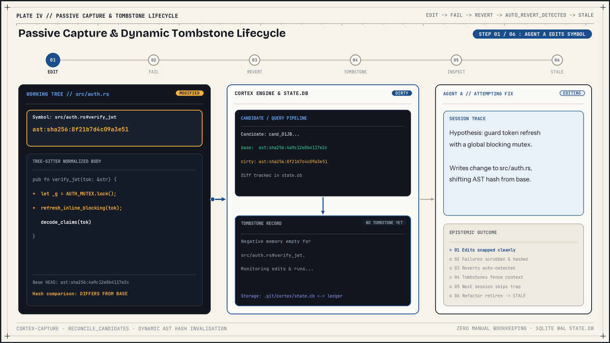
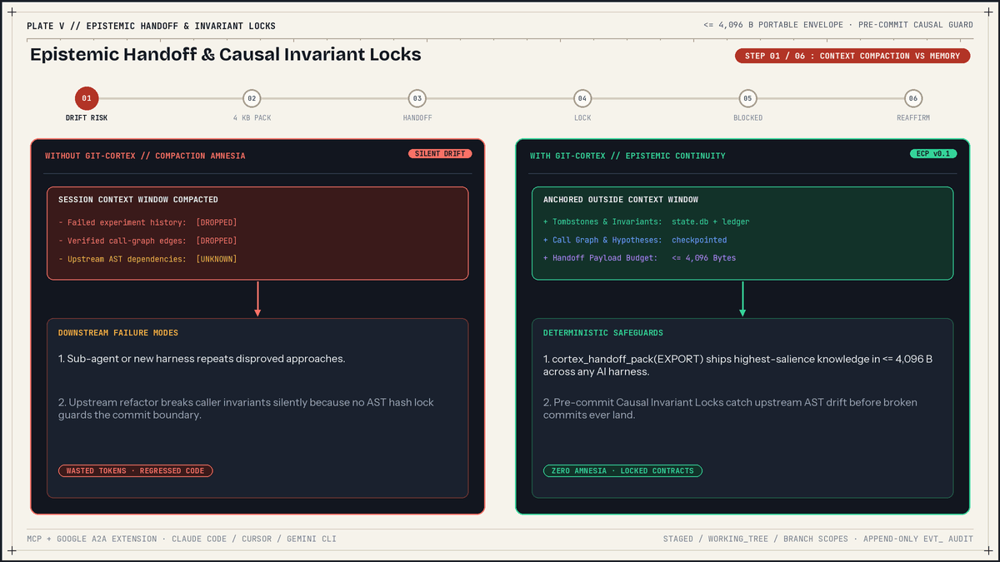

# Concepts and storage internals

`git-cortex` separates fast, local agent working memory from shared repository history. Transient execution logs, file-read tracking, call-graph hypotheses, and unpromoted records stay inside a local SQLite database under `.git/cortex/`. Durable negative-knowledge tombstones, causal invariant locks, and lifecycle events promote into an orphan Git commit tree under `refs/cortex/ledger`.

## Two-tier storage architecture

| Aspect | Tier 1: local SQLite cache | Tier 2: distributed Git ledger |
|---|---|---|
| Location | `.git/cortex/state.db` or `<commondir>/cortex/state.db` | `refs/cortex/ledger` orphan commit graph |
| Durability | Rebuilt from ledger via `git cortex reindex` | Immutable Git blobs pushed and fetched across remotes |
| Contents | All 9 local tables, candidates, exec logs, graph state | Promoted `TOMBSTONE`, `INVARIANT`, and `EVENT` JSON blobs |
| Concurrency | SQLite WAL mode with `busy_timeout = 5000` | Compare-and-swap commit retries and set-union tree merges |
| Tracked files touched | None | None |

### Tier 1: SQLite WAL state database

`CortexRepo::discover` locates the repository root and calls `CortexRepo::resolve_commondir`. In a primary checkout, `cortex_dir` is `<repo>/.git/cortex`. In a linked checkout created with `git worktree`, `resolve_commondir` reads `<git_dir>/commondir`, joins the relative path, canonicalizes it, and points `state.db` to `<commondir>/cortex/state.db`. All worktrees attached to the same repository share one `state.db` and one `refs/cortex/ledger`.

When opening `state.db`, `crates/cortex-storage/src/migrations.rs` applies three pragmas:

```sql
PRAGMA journal_mode = WAL;
PRAGMA busy_timeout = 5000;
PRAGMA foreign_keys = ON;
```

`PRAGMA synchronous = NORMAL` is not configured in `v0.1.0`, so SQLite uses its WAL default (`FULL`). Schema creation checks `PRAGMA user_version`. When the version is below `1`, `apply_migrations` opens a `TransactionBehavior::Immediate` transaction, creates all 9 tables and 6 indexes, and sets `PRAGMA user_version = 1`.

| Table | Primary key | Purpose and columns |
|---|---|---|
| `records` | `id` | Local cache of `TOMBSTONE`, `INVARIANT`, and `EVENT` records (`id`, `kind`, `json`, `origin`, `promoted` default `0`, `branch`, `created_at`, `content_hash`). |
| `record_symbols` | None | Maps each record to bound symbol URIs (`record_id` FK referencing `records(id)` with `ON DELETE CASCADE`, `symbol_uri`, `path`, `ast_hash`, `role`). |
| `symbol_cache` | `(path, blob_oid)` | Persistent symbol cache table (`path`, `blob_oid`, `symbols_json`). Defined with helper methods in `db.rs`, while engine and capture use the in-memory `SymbolCache`. |
| `execs` | `id` | Captured command runs (`id`, `cmd`, `exit_code`, `signature`, `output_tail`, `tree_hash`, `started_at`, `duration_ms`). In `v0.1.0`, `execute_command` mints `execs.id` with the `chk_` prefix. |
| `candidates` | `id` | Passive-capture failure candidates (`id`, `state`, `base_commit`, `symbols_json`, `diff`, `exec_ids`, `created_at`). |
| `checkpoints` | `id` | Snapshot metadata (`id`, `branch`, `snapshot_ref`, `objective`, `state_json`, `created_at`). |
| `file_reads` | `(path, branch)` | Recorded file digests per branch (`path`, `blob_oid`, `branch`, `read_at`) used during handoff assembly. |
| `call_graph_edges` | `(caller, callee, branch)` | Verified call relationships per branch (`caller`, `callee`, `relationship`, `verified_ast_hash`, `branch`). |
| `hypotheses` | `(hypothesis_id, branch)` | Active investigation hypotheses per branch (`hypothesis_id`, `statement`, `confidence`, `status`, `next_verification_step`, `branch`). |

Six indexes accelerate symbol and branch lookups:

- `idx_rs_path` on `record_symbols(path)`
- `idx_rs_symbol_uri` on `record_symbols(symbol_uri)`
- `idx_rs_ast_hash` on `record_symbols(ast_hash)`
- `idx_records_kind_branch` on `records(kind, branch)`
- `idx_record_symbols_record_id` on `record_symbols(record_id)`
- `idx_record_symbols_path_role` on `record_symbols(path, role)`

`save_records_batch` wraps inserts into `records` and `record_symbols` inside one `TransactionBehavior::Immediate` transaction. Single-record writes call `save_record` and `index_record_symbols` as separate database operations. `EpistemicHandoff` payloads are assembled on demand and are never stored in `records`.

### Tier 2: Distributed Git ledger (`refs/cortex/ledger`)

`git cortex promote` and the `post-commit` hook publish unpromoted local `TOMBSTONE`, `INVARIANT`, and `EVENT` records to the orphan commit graph at `refs/cortex/ledger`. `EpistemicHandoff` envelopes stay outside the ledger.

Each record is serialized to canonical JSON (RFC 8785) and written inside the ledger tree at `v1/<kind>/<shard>/<id>.json`:

```text
refs/cortex/ledger (commit tree)
└── v1/
    ├── tombstones/
    │   └── 2r/
    │       └── tmb_01JBYN8W8X26Z6C8A79P0K4Z2R.json
    ├── invariants/
    │   └── zc/
    │       └── inv_01JBYN9QWW847KP3308RT65NZC.json
    └── events/
        └── tv/
            └── evt_01JBYNA97T5632N7B60Q123RTV.json
```

`LedgerRecord::shard` takes the trailing two characters of `id` in lowercase (`"00"` if shorter than two characters). Because ULID suffixes vary uniformly across Crockford Base32 characters, records spread across 1,024 shards.

`CortexLedger::append_records` updates `refs/cortex/ledger` using a 5-attempt compare-and-swap loop. If `repo.commit` fails with `git2::ErrorCode::Modified` or a `"changed while committing"` error, the writer sleeps `10 * (attempt + 1)` ms (`10`, `20`, `30`, `40` ms between retries) and rebuilds the tree against the new ledger parent commit.

To share records without overwriting divergent remote state, `git cortex init` configures `remote.origin.fetch` with `+refs/cortex/ledger:refs/remotes/origin/cortex/ledger` and migrates any older direct refspec `+refs/cortex/ledger:refs/cortex/ledger`.

During `git cortex sync` (and `git cortex sync --rebase`), `crates/cortex-engine/src/sync.rs` runs four steps:

1. Run `git fetch <remote> refs/cortex/ledger:refs/remotes/<remote>/cortex/ledger`. Fetch failures on remotes without a ledger yet emit a notice and continue.
2. When the remote-tracking ref exists, call `CortexLedger::merge_commits`. If the local ledger is empty or behind, it fast-forwards `refs/cortex/ledger`. If commits diverged, it walks both trees into maps and merges entries by set-union. When the same tree path maps to two different blob OIDs, merge aborts with `"Tamper alert: conflicting content detected for record path '<path>'"`.
3. Call `CortexLedger::reindex_into_db` to rebuild local SQLite rows from the merged tree.
4. Push `refs/cortex/ledger:refs/cortex/ledger` in a 5-attempt loop (`MAX_SYNC_RETRIES = 5`). On rejected or non-fast-forward errors (or any push failure when `--rebase` passes `force_rebase = true`), it sleeps `50 * (1 << attempt)` ms (`50`, `100`, `200`, `400` ms), re-fetches, union-merges, reindexes, and retries. Persistent push failures return `Err(CortexError::Git)`.

`CortexLedger::reindex_into_db` infers kind from `/tombstones/` or `/invariants/` in the entry path (defaulting to `EVENT`), computes a `sha256:` content digest over the raw blob bytes, reads `branch_context` (default `"main"`) and `created_at` (fallback `Utc::now()`), indexes `record_symbols`, and writes to SQLite in 500-record batches. In `v0.1.0`, `walk_tree_and_index` splits symbol URIs using `.split('#').next()` (not `parse_symbol_uri`), so paths containing `#` lose their suffix during reindex.

### Snapshot namespaces and isolated index handling

Working-tree snapshots live under three separate ref namespaces written by `CortexSnapshot::create_snapshot`:

- `refs/cortex/checkpoints/<chk_id>` stores manual and agent checkpoints.
- `refs/cortex/backups/<new_chk_id>` stores dirty worktree state captured right before `rewind`.
- `refs/cortex/untracked/<checkpoint_id>` captures untracked files before `rewind` removes them.

To snapshot tracked, staged, modified, and untracked files without touching `.git/index`, `create_snapshot` opens an isolated temporary index file `tmp_index_<id>` inside `<repo.path()>/cortex/` (using `repo.path().join("cortex")` directly in `v0.1.0`, separate from `resolve_commondir`). It calls `repo.set_index(&mut temp_index)`, seeds from `HEAD`, runs `update_all` and `add_all`, writes the Git tree object, restores the live index, and deletes the temporary index file. `CortexSnapshot::restore_snapshot` checks out the snapshot tree using `CheckoutBuilder::force().remove_untracked(true)` and resets the live index to match the restored tree.

## Tree-sitter AST extraction and normalized hashing

File line numbers shift whenever code is added or removed above a function. `git-cortex` anchors tombstones and invariants to canonical symbol URIs (`<relative_path>#<scope_chain>`) paired with a structural subtree digest (`ast:sha256:<16-hex-chars>`).

### URI normalization and language support

`crates/cortex-ast/src/uri.rs` normalizes file paths in `normalize_rel_path` by converting `\` to `/`, stripping Windows drive prefixes (`C:` or `c:`), dropping empty and `.` segments, and popping `..` segments. `parse_symbol_uri` splits on the rightmost `#` (`rsplit_once('#')`) so paths such as `src/c#/lexer.cs#Lexer::tokenize` resolve cleanly.

Language detection in `crates/cortex-ast/src/lang.rs` maps file extensions to Tree-sitter grammars and scope separators:

| Language | Extensions | Scope separator |
|---|---|---|
| Rust | `rs` | `::` |
| TypeScript | `ts`, `mts`, `cts` | `.` |
| TSX | `tsx` | `.` |
| JavaScript | `js`, `mjs`, `cjs`, `jsx` | `.` |
| Python | `py`, `pyi` | `.` |
| Go | `go` | `.` |
| Unsupported | Any other extension | `.` (uses `#<file>` fallback) |

### Scope chains, overloads, and line ranges

`crates/cortex-ast/src/extract.rs` walks each parsed syntax tree with a mutable `scope_stack` and records these constructs:

| Language | Extracted constructs and scope rules |
|---|---|
| Rust | `mod_item` pushes module name onto `scope_stack` without emitting a symbol. `struct_item`, `enum_item`, and `trait_item` emit symbols and push scope. `impl_item` strips generic `<...>` suffixes and pushes `Base` or `Base<as Trait>` onto `scope_stack`. `function_item` emits `Function` at top level or `Method` inside scope. Trait declarations without bodies (`function_signature_item`) are not extracted. |
| TypeScript / TSX / JS | `class_declaration` emits `Class` and pushes scope. `interface_declaration` (TS/TSX only) emits `Interface` and pushes scope. `function_declaration`, `function_signature` (TS/TSX only), and `variable_declarator` bound to `arrow_function` or `function` emit `Function`. `method_definition` emits `Method`. |
| Python | `class_definition` emits `Class` and pushes scope. `function_definition` emits `Function` at top level or `Method` inside a class. |
| Go | `function_declaration` emits `Function`. `method_declaration` reads the receiver parameter type, strips leading `*`, and formats `<Receiver>.<Method>` as `Method`. `type_declaration` iterates every child `type_spec` and `type_alias`, emitting `Interface`, `Struct`, or `Type`. |

Function bodies do not push onto `scope_stack`, so nested helper functions defined inside another function share the parent's enclosing scope. When two symbols in the same file resolve to the same scope chain (for example TypeScript function overloads), `disambiguate_scope` appends `[2]`, `[3]`, and higher ordinals. Each symbol computes `line_range` with 1-based start row (`start.row + 1`) and exclusive end row (`end.row + 1` when `end.column == 0 && end.row > start.row`, otherwise `end.row + 2`).

### Normalized AST hashing algorithm

`compute_ast_hash_for_lang` in `crates/cortex-ast/src/hash.rs` hashes the subtree of each extracted symbol node:

1. Skip every comment node (`comment`, `line_comment`, `block_comment`, `doc_comment`, `inner_doc_comment`, `outer_doc_comment`).
2. When `lang == Language::Python` and not at the symbol root, skip `is_python_docstring`: an `expression_statement` whose first named child is `string` or `concatenated_string` and which is the first non-comment named child of a `block` or `module`.
3. For internal nodes, write `(<kind>:`, recurse across all `0..node.child_count()` children (including both named AST nodes and unnamed punctuation/operator/keyword tokens), and write `)`.
4. For leaf nodes (`child_count() == 0`), read UTF-8 source slice, trim leading/trailing whitespace, replace `\r\n` with `\n`, and skip empty strings. Write `<kind>:<len>:<norm>;` for named leaves or `tok:<len>:<norm>;` for unnamed tokens.
5. Finalize SHA-256 and take the first 16 hex characters (`ast:sha256:<16-hex>`).

| Edit in source code | Changes `ast_hash`? | Reason |
|---|---|---|
| Add, edit, or delete comments or doc comments | No | All comment node kinds are skipped before hashing |
| Add, edit, or delete Python docstrings | No | Leading string statements in Python `module`/`block` are skipped |
| Reformat indentation, spacing, or blank lines | No | Whitespace outside tokens is excluded and leaves are trimmed |
| Switch line endings between CRLF and LF | No | Leaf normalization converts `\r\n` to `\n` |
| Rename a variable, function, or parameter | Yes | Named leaf tokens include identifier text verbatim |
| Change a literal, operator, type annotation, or statement order | Yes | Both named leaves and unnamed tokens enter the hash stream |

### Fallback symbols and in-memory caching

Files larger than 2 MiB (`2 * 1024 * 1024` bytes) or containing a null byte (`\0`) in the first 1,024 bytes produce a single `SymbolKind::File` entry at `<path>#<binary>` with `line_range: 1..2` and `ast:sha256:<first 16 hex chars of raw SHA-256>`.

Files with unsupported extensions, or supported source files that yield zero extracted symbols, emit a single `SymbolKind::File` entry at `<path>#<file>` with `line_range: 1..line_count + 1`. Its hash comes from `compute_text_fallback_hash`, which trims each line, drops blank lines, joins remaining lines with `\n`, and takes the first 16 hex chars of SHA-256.

`CortexRepo::extract_symbols_cached` wraps `crates/cortex-storage/src/cache.rs::SymbolCache`, an in-memory `RwLock<HashMap<(PathBuf, [u8; 32]), Vec<Symbol>>>` keyed by relative path and raw file SHA-256 digest.

## Dynamic invalidation and lifecycles

`git-cortex` evaluates record validity at query time by comparing stored AST hashes against live symbol extraction and scanning `EVENT` records.



### Query-time status evaluation

During `inspect_symbol` (`crates/cortex-engine/src/inspect.rs`) and `verify_invariants` (`crates/cortex-engine/src/invariant.rs`):

- `ACTIVE`: All bound symbols (for tombstones, every entry in `target_symbols`; for invariants, `guarded_symbol` and every entry in `upstream_dependencies`) exist in the current scope with identical `ast_hash`, and no `REVOKE` event targets the record ID.
- `STALE`: Any bound `ast_hash` differs from the current code, or a bound symbol or file no longer exists on disk. While `DerivedStatus::Orphaned` is defined in `crates/cortex-core/src/schema.rs`, `inspect_symbol` does not emit it in `v0.1.0`; missing symbols and deleted files appear in `stale_tombstones` and `stale_invariants` under `<!-- STALE ... -->`.
- `REVOKED`: An `EVENT` record with `event_type == REVOKE` references the record ID. `inspect_symbol` emits `<!-- REVOKED ... -->` and `verify_invariants` skips the contract.

`EventType::Supersede` exists in `schema.rs` and `schemas/v0.1/event.json`, though no `v0.1.0` command writes or evaluates `SUPERSEDE` events.

### Revoke and reaffirm operations

`crates/cortex-engine/src/lifecycle.rs` provides two lifecycle transitions:

1. `revoke_record`: verifies the target record exists, constructs a `LifecycleEvent` (`evt_...`) with `EventType::Revoke`, and saves it to SQLite (`origin = "LOCAL"`, `promoted = false`). It does not deduplicate repeated revokes for the same `target_id`.
2. `reaffirm_invariant`: looks up an existing `INVARIANT` record, recomputes live `ast_hash` values for `guarded_symbol` and every upstream dependency (falling back to `ast:sha256:0000000000000000` if missing), updates `commit_sha`, overwrites the `INVARIANT` row in SQLite with `promoted = false` and `origin = "LOCAL"`, re-indexes `record_symbols`, and writes an `EventType::Reaffirm` event.

Because `reaffirm_invariant` overwrites the existing `INVARIANT` row in place and sets `promoted = false`, independently reaffirming and promoting the same `inv_<ULID>` on two branches creates two different blob OIDs at the same `v1/invariants/<shard>/<id>.json` ledger path. Merging those branches via `CortexLedger::merge_commits` triggers a tamper alert during `git cortex sync`.

## Passive capture, rewind, and epistemic handoffs



### Passive capture loop (`exec` and `reconcile_candidates`)

`crates/cortex-capture/src/exec.rs::execute_command` turns failed edits that are later reverted into `AUTO_REVERT_DETECTED` tombstones:

1. `find_dirty_symbols` scans tracked modified files (`include_untracked(false)`) and diffs AST hashes against `HEAD`, recording `(symbol_uri, base_ast_hash, dirty_ast_hash)`.
2. `Command::new` spawns the command in `repo.workdir` (inside a new Unix `process_group(0)`). Two background threads drain stdout and stderr concurrently with `read_to_end` into memory (no streaming byte cap in `v0.1.0`).
3. If `timeout_secs > 0` expires, Unix sends `SIGKILL` to the process group and Windows invokes `taskkill /F /T /PID`, returning exit code `124`.
4. Output is echoed to the user terminal. `extract_error_signature` (`crates/cortex-capture/src/signature.rs`) scans combined lines in reverse for `"error:"`, `"fail"`, `"assertion"`, `"panic"`, `"timeout"`, `"exception"`, or `"traceback"`, falling back to the last non-empty line or `"Non-zero exit code with empty output"`. It normalizes `0x[0-9a-fA-F]+` to `0x<HEX>` and `\d{1,2}:\d{2}(:\d{2})?` to `<TIME>`, then truncates above 300 bytes at a UTF-8 boundary (`297` bytes + `"..."`).
5. `safe_tail_utf8` stores up to 4,096 UTF-8 bytes in `execs.output_tail`.
6. On non-zero exit with dirty symbols, `check_baseline_failure` checks `execs` for an earlier identical `(cmd, signature)` recorded with `tree_hash == "wt:clean"`. Clean-tree matches suppress candidate creation so pre-existing test failures do not turn into false tombstones. Otherwise, a `FAILED` row is saved to `candidates`.
7. `reconcile_candidates` (`crates/cortex-capture/src/candidate.rs`) runs at the end of `execute_command`, on `post-checkout` and `post-merge` hooks, and on every MCP `tools/call`. Each `FAILED` candidate partitions its symbols into reverted (`current_ast_hash == base_ast_hash`) and unreverted sets. Reverted symbols are promoted via `record_tombstone` with `CaptureMode::AutoRevertDetected` and `author_harness = "git-cortex/passive-capture"`. When all symbols revert, the candidate becomes `"PROMOTED"`. When only a subset reverts, `symbols_json` updates to keep the unreverted symbols and `state` remains `"FAILED"`.

### Checkpoints and 5-step rewind

`checkpoint_state` (`crates/cortex-engine/src/checkpoint.rs`) captures a working-tree snapshot under `refs/cortex/checkpoints/<chk_id>`, upserts `call_graph_edges` and `hypotheses` for the current branch, and stores `{edge_count, hypothesis_count}` in `checkpoints.state_json`.

`rewind_to_checkpoint` (`crates/cortex-engine/src/rewind.rs`) executes five steps to roll back an aborted branch of work:

1. Capture current dirty worktree state to `refs/cortex/backups/<new_chk_id>`.
2. Call `find_modified_symbols_against_checkpoint` using `diff_tree_to_workdir_with_index` to collect symbol URIs whose AST hashes changed or were newly added relative to the checkpoint tree. Deleted files and deleted symbols are skipped (`if !full_path.exists() { continue; }`).
3. Snapshot untracked files under `refs/cortex/untracked/<checkpoint_id>` before checkout removes them.
4. Restore the working tree and live Git index to `<checkpoint_id>` via `CortexSnapshot::restore_snapshot` (`force().remove_untracked(true)`).
5. Insert a `CaptureMode::RewindSynthesized` tombstone (`command = "cortex rewind"`, `error_signature = "ABORTED_WORKTREE_REWIND"`) into `state.db` bound to the modified symbols.

`rewind_to_checkpoint` restores files and records the synthesized tombstone, without rolling back rows in SQLite `call_graph_edges` or `hypotheses`.

### Epistemic handoff compaction and salience scoring

`create_handoff_envelope` (`crates/cortex-engine/src/handoff.rs`) packs session state into `EpistemicHandoff` within `MAX_HANDOFF_BYTES = 4096`. It omits `REVOKED` tombstones (retaining stale tombstones) and populates `do_not_re_read_unchanged` by comparing `sha256_digest(&file_bytes)` (`sha256:<64hex>`) against `file_reads.blob_oid`.

Remaining tombstones are sorted by descending composite salience:

```text
salience = 0.50 * prox_score + 0.35 * bm25_score + 0.15 * decay_score
```

- `prox_score`: `1.0` if the symbol is in a dirty file, `0.7` if 1 hop away in `verified_call_graph`, `0.3` if 2 hops away, `0.1` otherwise.
- `bm25_score`: fraction of alphanumeric objective tokens (length >= 3) appearing in the tombstone's `failure_reason`, `attempted_approach`, `error_signature`, or `target_symbols`, capped at `1.0` (`0.5` when the objective has no tokens >= 3 chars).
- `decay_score`: fixed at `1.0` in `v0.1.0`.

If serialized JSON exceeds 4,096 bytes, `enforce_byte_budget` sheds fields in seven ordered tiers:

1. Clear `do_not_re_read_unchanged`.
2. Remove low-confidence hypotheses (`confidence < 0.5`), lowest confidence first.
3. Remove oldest `verified_call_graph` edges from the front.
4. Remove medium-confidence hypotheses (`confidence < 0.8`), lowest confidence first.
5. Pop lowest-salience IDs from the tail of `active_tombstone_ids`.
6. Remove remaining high-confidence hypotheses, lowest confidence first.
7. Truncate `objective` at UTF-8 character boundaries with `"..."` (or clear `objective` if still above 4,096 bytes).

For cross-agent transport, `format_a2a_task_envelope` wraps `handoff_id` and `epistemic_handoff` inside a JSON-RPC 2.0 `tasks/send` request under `params.metadata["https://git-cortex.dev/a2a-extension/v0.1"]`.

## Further reading

- [Architecture and crate design](./ARCHITECTURE.md)
- [ECP v0.1 specification](./spec/ECP-v0.1.md)
- [Schemas reference](./SCHEMAS.md)
- [CLI reference](./CLI-REFERENCE.md)
- [Security policy](../SECURITY.md)
